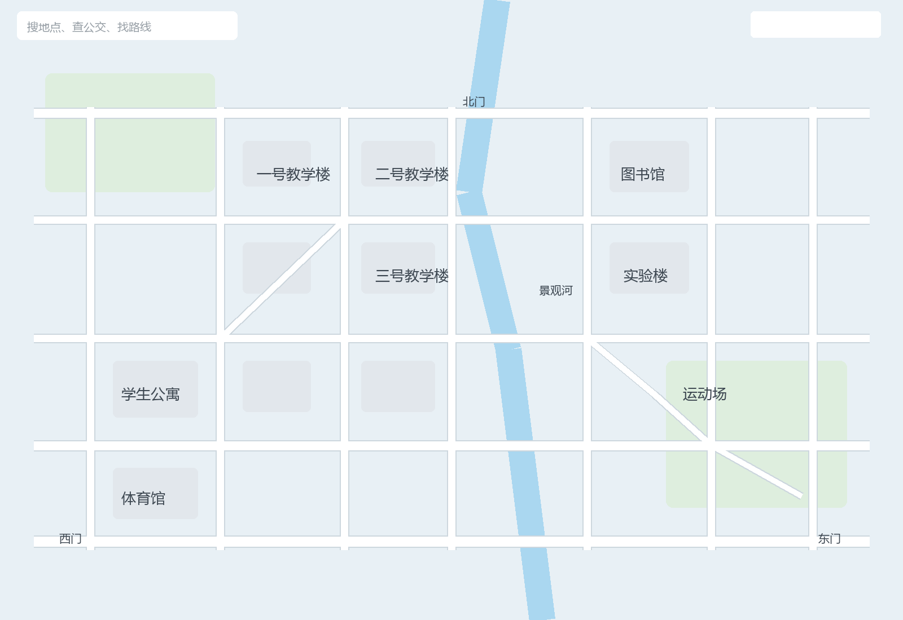
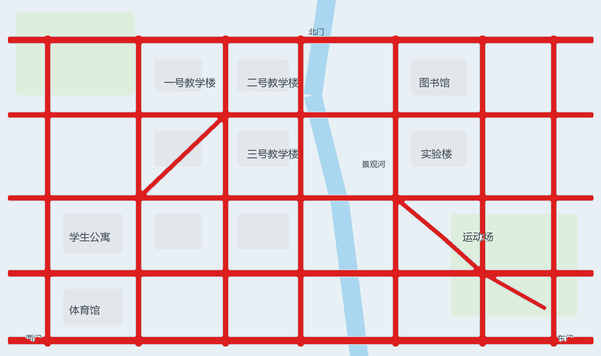

# map-road-extractor

**把一张地图截图，变成能算最短路的图结构。**

[](https://www.python.org/)
[](LICENSE)

不需要 OSM，不需要 API key，不需要矢量数据。
给一张高德 / 百度 / Google / OSM 截图，或者任何一张校园、园区平面图，
几十秒内得到一份可以直接寻路的路网。

```bash
python road_from_map.py --image campus.png --out ./out
# -> out/roadgrid.json   (11 KB，浏览器端可直接跑 Dijkstra)
```

---

## 效果

左：原始截图（含地名文字、搜索框 UI）。右：自动提取出的路网。

| 原始地图 | 提取结果 |
| :---: | :---: |
|  |  |

红色为识别出的道路，与白色路面完全重合；地名文字与搜索框已被自动剔除。

真实场景实测（某高校临港校区，2628×1852 高德截图）：

| 指标 | 结果 |
| --- | --- |
| 识别道路像素 | 31.7 万（占全图 6.3%） |
| 寻路网格 | 181 × 121，6083 个道路格 |
| 路网 JSON | 11 KB |
| 11 条测试路线 | 全部通畅，最大绕远倍率 **2.05**（正常路网水平） |
| 典型路线 | 宿舍→一教 1.9 分 ｜ 二教→3号门 2.2 分 ｜ 宿舍→环化楼 5.0 分 |

---

## 为什么做这个

**校园内部道路在 OpenStreetMap 上常年缺失或过时**，商业导航 API 又拿不到楼栋级精度。
但每个人手里都有一张学校的高德截图。

而这些截图里的道路，本质上就是**画成白色的线条** —— 这就能被程序读出来。

---

## 安装

```bash
pip install -r requirements.txt     # numpy, pillow, scipy
```

## 快速开始

```bash
python road_from_map.py --image campus.png --out ./out
```

浏览器或图片查看器打开 `out/debug_overlay_on_map.png` 检查贴合度，
打开 `out/roads_only.png` 检查有没有文字残留。

### 产物

| 文件 | 说明 |
| --- | --- |
| `roadgrid.json` | 栅格路网（RLE 压缩），前端可直接解析寻路 |
| `road_overlay.png` / `road_overlay_b64.txt` | 半透明青色路网层，直接盖在底图上 |
| `base_map_cropped.png` | 裁切后的底图，与 roadgrid 坐标对齐 |
| `roads_only.png` | 纯路网二值图，肉眼验收提取质量 |
| `debug_overlay_on_map.png` | 红线路网压底图，核对贴合度 |

---

## 原理

```
地图截图
   │
   ├─ ① 阈值掩膜      道路画成高亮白色线条
   │                  条件：min(R,G,B) ≥ 243 且 max−min ≤ 9
   │
   ├─ ② 形态学净化    开运算 r=2  削掉文字/图标的细笔画
   │                  闭运算 r=3  把被削断的路面接回
   │
   ├─ ③ 裁切          去掉地图自带搜索框/工具栏 + 城外孤立道路
   │
   └─ ④ 栅格化        膨胀 5px 弥合断口 → 格内密度 ≥ 0.18 判为道路格
                      → 按行 RLE 压缩
```

---

## 三个关键设计决策

### 1. 视觉层和寻路层用两份掩膜

形态学去文字的同时会把细路面削成虚线。
如果直接拿净化后的掩膜建寻路网格，**路线会绕远 8 倍**
（实测：某路段从 804px 变成 3391px）。

所以工具内部维护两份：

| 层 | 掩膜 | 为什么 |
| --- | --- | --- |
| 视觉层 | 净化后 | 干净、无文字，好看 |
| 寻路层 | 原始未净化 | 连通完整，不绕远 |

### 2. 网格化前必须膨胀弥合断口

细路面在网格抽样时会断成一段段，Dijkstra 遇到断点只能绕圈。

`--dilate 5` 这一个参数，把最大绕远倍率从 **8.8 压到 2.08**。

### 3. 不用 CSS mask 给路网着色

试过 1-bit PNG + `-webkit-mask-image`（体积只要 20 KB），
结果**整张地图被铺满颜色** —— mask 静默失效且不报错。

改用 Python 直接生成 RGBA PNG 当普通 `` 叠加。
体积 60 KB，但 100% 可靠。

---

## 调参速查

| 现象 | 调整 |
| --- | --- |
| 浅色街区被误判成路 | `--min-channel 246 --max-sat 6` |
| 较浅的路面被漏掉 | `--min-channel 240 --max-sat 10` |
| 还有文字残留 | `--open-r 3`（上限 3，再大就削掉细路了） |
| 路面被削成虚线 | 加大 `--close-r`，或 `--no-visual-clean` |
| 出现"不通" | 加大 `--dilate`，或调低 `--density` |
| 路线绕大圈 | 加大 `--dilate`（首选） |
| 搜索框被当成路 | `--crop x0,y0,x1,y1` 显式裁掉 |

完整参数说明见 [`SKILL.md`](SKILL.md)。

---

## 作为 Agent Skill 使用

本仓库同时是一个 **Agent Skill**。
`SKILL.md` 使用通用的 YAML frontmatter 格式（`name` + `description`），
适用于任何支持 SKILL.md 的 Agent 运行时：

- Claude Skills / Claude Code
- DeepSeek Harness
- 其它实现了 skill 目录扫描的 Agent 框架

把整个目录放进 Agent 的 skills 目录即可；也可以完全当作独立命令行工具使用。

---

## 前端寻路（消费 roadgrid.json）

```js
// 1. RLE 还原成道路格
const road = new Uint8Array(GW * GH);
for (let r = 0; r < GH; r++)
  for (const [a, b] of DATA.rows[r])
    for (let c = a; c <= b; c++) road[r * GW + c] = 1;

// 2. 8 邻接 Dijkstra，斜向代价 √2
//    关键：斜向移动必须至少一个正交邻居也是道路，否则会斜穿拐角
```

其余要点：

- 地标先**吸附到最近道路格**（逐环向外搜索）——
  这就是"骑车到楼前，再步行进楼"的建模方式
- 路径用 **Douglas-Peucker** 简化后绘制，避免几千个点
- 时间换算：`像素长度 ÷ px_per_min`

---

## 适用范围与限制

**适用**

- 高德 / 百度 / Google / OSM 风格的地图截图
- 道路以浅色或白色线条绘制
- 校园、园区、小区级别的平面图

**不适用**

- 卫星影像（没有矢量道路线条）
- 道路与背景对比度极低的手绘图
- 需要精确地理坐标的场景（本工具输出的是**图像像素坐标**）

---

## 验证方法

**不要靠读代码判断前端渲染是否正确。** 用无头浏览器截图实际看：

```bash
msedge.exe --headless=new --disable-gpu --hide-scrollbars \
  --window-size=1900,1150 --virtual-time-budget=15000 \
  --screenshot=out.png "file:///绝对路径/page.html"
```

判断标准：

| 现象 | 含义 |
| --- | --- |
| 颜色铺满整图 | mask 失效 |
| 线条虚断 | 连通性问题，加大 `--dilate` |
| 路线绕大圈 | 网格断点 |

---

## License

[MIT](LICENSE)
